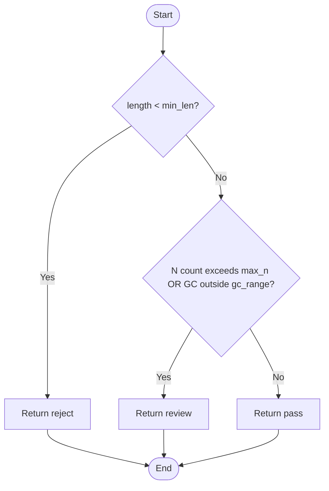
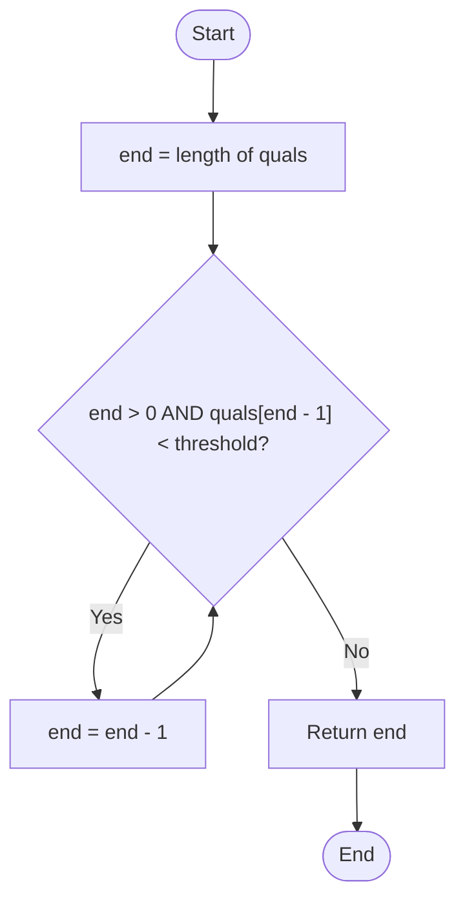

## Problem

### Input

The sequence quality control (QC) algorithm processes DNA sequencing records and quality scores to determine whether sequencing reads meet predefined quality requirements.

#### `classify_read()`
Receives three input values:
- `length`: Total number of bases in the sequencing read.
- `n_count`: Number of ambiguous bases (`N`) in the read.
- `gc`: GC percentage of the read.
Uses three keyword-only parameters with default values:
- `min_len = 500`: Minimum acceptable read length.
- `max_n = 10`: Maximum acceptable number of ambiguous bases.
- `gc_range = (30.0, 70.0)`: Inclusive acceptable GC percentage range.

#### `qc_summary()`
Receives `records`, a list of dictionaries containing:
- `length`: Read length.
- `n_count`: Number of ambiguous bases.
- `gc_percent`: GC percentage.
Values may be numeric or strings obtained from a CSV file.

#### `trim_low_quality()`
Receives `quals`, a list of sequencing quality scores. Uses `threshold = 20` as the default minimum acceptable quality score.

### Output

#### `classify_read()`
Returns one of three lowercase string labels:
- `"reject"`: Read length is below `min_len`.
- `"review"`: Read length meets the minimum requirement, but N count exceeds `max_n` or GC percentage is outside `gc_range`.
- `"pass"`: Read satisfies all classification conditions.

#### `qc_summary()`
Returns a dictionary containing the total number of reads in each classification category:

```python
{"pass": n, "review": n, "reject": n}
```

- Each record contributes to exactly one category.
- All three keys must always be present, even when their counts are zero.
- An empty input list returns zero for all categories.

#### `trim_low_quality()`
Returns an integer representing the index where the low-quality 3' tail begins, which is also the number of bases to retain.
- Returns `0` for an empty quality-score list.
- Returns `0` if all quality scores are below the threshold.
- Does not return a modified sequence or quality-score list.

### Constraints

#### Classification rules and priority
- Check read length first. If `length < min_len`, return `"reject"` immediately.
- Otherwise, return `"review"` if `n_count > max_n`, `gc < gc_range[0]`, or `gc > gc_range[1]`.
- Return `"pass"` only if none of the rejection or review conditions applies.
- A short read with an unacceptable GC percentage must be rejected rather than reviewed.
- The function must return a string without printing.
- The three classification thresholds must remain keyword-only parameters.

#### Boundary conditions
- Length `499` is rejected; length `500` satisfies the length requirement.
- N count `10` is acceptable; N count `11` triggers review.
- GC percentages `30.0` and `70.0` are acceptable because both boundaries are inclusive.
- GC values below `30.0` or above `70.0` trigger review, provided the length requirement is satisfied.

#### Summary processing
- Convert CSV text values to appropriate numeric types (`int` and `float`) before comparison.
- Count every record using the classification rules.
- Preserve all three output dictionary keys, including for empty input.
- Do not modify the original records.

#### Quality-score trimming
- Start checking quality scores from the 3' end (rightmost element).
- Continue moving left while the trailing quality score is strictly below `threshold`.
- A quality score equal to the threshold must be retained.
- Low-quality scores occurring before a retained score must not be removed.
- Use a `while` loop with the boundary guard `end > 0` before accessing `quals[end - 1]`.
- Do not modify the original quality-score list.

## Pseudocode

```text
CONSTANT MIN_LEN = 500
CONSTANT MAX_N = 10
CONSTANT GC_LOW = 30.0
CONSTANT GC_HIGH = 70.0
CONSTANT QUALITY_THRESHOLD = 20

FUNCTION classify_read(length, n_count, gc, *, min_len = MIN_LEN, max_n = MAX_N, gc_range = (GC_LOW, GC_HIGH))
    IF length < min_len THEN
        RETURN "reject"
    ENDIF

    IF n_count > max_n OR gc < gc_range[0] OR gc > gc_range[1] THEN
        RETURN "review"
    ENDIF

    RETURN "pass"
ENDFUNCTION

FUNCTION trim_low_quality(quals, threshold = QUALITY_THRESHOLD)
    end = LENGTH(quals)

    WHILE end > 0 AND quals[end - 1] < threshold
        end = end - 1
    ENDWHILE

    RETURN end
ENDFUNCTION
```

## Flowchart

### `classify_read()`



### `trim_low_quality()`



## Trace

| sample | length | n_count | gc | length < 500? | N > 10? | GC outside 30-70? | decision |
|---|---:|---:|---:|---|---|---|---|
| R03 | 420 | 0 | 68.5 | Yes | — | — | reject |
| R04 | 500 | 10 | 45.0 | No | No | No | pass |
| R05 | 640 | 3 | 72.4 | No | No | Yes | review |
| R07 | 499 | 0 | 50.0 | Yes | — | — | reject |

`—` indicates a condition that was not evaluated 
